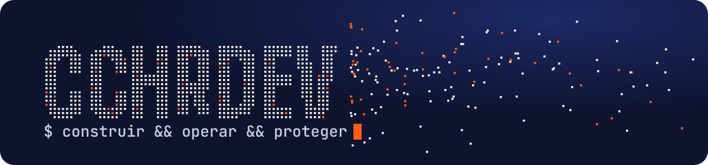

Escribo la aplicación, monto el servidor donde vive y reviso por dónde se la pueden tumbar. La mayoría de los equipos reparte eso entre tres perfiles.

## Proyectos

| Proyecto | Qué es | Con qué |
|---|---|---|
| [**TESSYRIUM**](https://github.com/cchrdev/TESSYRIUM) | Plataforma de consola que orquesta nmap, ssh-audit y testssl. No escanea nada fuera del alcance firmado del proyecto. | Python · Typer · Textual |
| **Tomín** | App personal para tarjetas de crédito: lee estados de cuenta en PDF con IA y proyecta si el dinero alcanza hasta el siguiente pago. | Flutter · Supabase · PostgreSQL |
| **Aether** | Fondos animados para Hyprland con motor propio, editor integrado y mezcla de audio por programa. | C++ · OpenGL · QML · PipeWire |
| **Alumbra** | Control de iluminación RGB sin el software del fabricante, a partir del protocolo descifrado. | Rust · iced · USB HID |

## Con qué trabajo

## Credenciales

CCNA (Introduction to Networks · Switching, Routing and Wireless Essentials · Enterprise Networking, Security and Automation) · Fortinet Certified Fundamentals in Cybersecurity · Python Essentials 1. Siguiente meta: certificación de analista SOC.

## Fuera de turno

Aprendo piano, patino, pesco, juego y sigo armando mi escritorio en Arch y Hyprland pieza por pieza.
